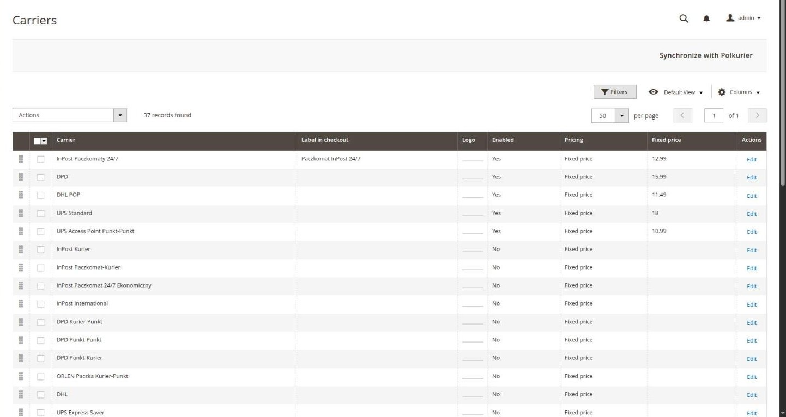

<!--
 ~ Copyright (c) 2026 Polkurier.pl
 ~ Licensed under the MIT License, see LICENSE.md
-->
# Carriers and prices

[User guide](README.md) › Carriers and prices

Carriers, their names at checkout and their prices are set under **Polkurier > Settings >
Carriers**.

## Fetching your carriers

Click **Synchronize with Polkurier**. The carriers available on your Polkurier account are added to
the list, switched off.

The list is also checked once a day, while the scheduled synchronization is on (see
[Configuration](configuration.md#synchronization)). Click the button when you want a change to
show at once.

- **Only some carriers listed?** Only the carriers selected under **Available carriers** in the
  [configuration](configuration.md#connecting-your-account) are listed. With none selected, all
  of them are.
- **A carrier your account no longer offers** disappears from the list and from checkout. Its
  settings are kept: if your account offers it again, it comes back as it was.
- **When carriers come or go**, a message in **System > Notifications** says which. If an order was
  placed with a carrier that's gone, the shipping screens point it out and ask you to choose
  another.

## Setting up a carrier

Click **Edit** on a carrier:

- **Enabled** offers the carrier to customers.
- **Label in checkout** is the name customers see, for example "Kurier DPD" or "Paczkomat
  InPost". They also see it in e-mails, on their order page and as the title of the tracking
  numbers. Leave it empty to use the carrier's own name.
- **Label per store view** gives the carrier another name in one store view, for example in
  English. Click **Add a store view label**, pick the store view and type the name. Other store
  views use the label above.
- **Logo in checkout** is shown in front of the carrier's name at checkout. Click **Upload** and
  choose a JPG, PNG, GIF or WebP file of about 60 × 30 pixels. To remove it, click the bin icon on
  the preview.
- **Pricing** sets what customers pay; see [Pricing](#pricing) below.

### Working in the list

- **Order at checkout**: checkout offers the carriers in the order of the list. Enabled carriers
  come first. To move a carrier, drag it by the handle at the start of its row, or focus the handle
  and press Alt+Up or Alt+Down. The new order is saved at once. A carrier new to your account comes
  last.
- **Quick edits**: click a row to change the label, **Enabled** or a fixed price, then click
  **Save** under it. Price tiers are edited on the carrier's page.
- **Several at once**: tick the carriers and choose **Enable / disable** from **Actions**. Each
  ticked carrier is switched to the opposite state.

## Pricing

The price you set is what the customer pays for shipping, whatever Polkurier charges you. Prices
are in your store's base currency.

Choose one of these under **Pricing**:

- **Fixed price**: the same price for every cart.
- **By cart subtotal**: the price depends on the value of the cart.
- **By cart weight**: the price depends on the total weight of the products, in kilograms. A store
  that weighs in pounds is converted.
- **By cart subtotal and weight**: each tier has a minimum value and a minimum weight, and the cart
  has to reach both.

With tiers, the customer pays the price of the highest tier the cart reaches.

**A cart that reaches no tier doesn't get the carrier at all.** Start your lowest tier at 0, unless
you want that, for example to offer a pallet carrier only for heavy carts.

The cart value is what the customer sees: after discounts, and with tax unless you set **Cart value
for price tiers** otherwise (see [Configuration](configuration.md#the-delivery-method)). The weight
is the sum of the product weights from the catalog.

### Examples

**Free shipping from 200 zł**, 14.99 zł below that, with **By cart subtotal**:

| Subtotal from | Price |
|---|---|
| 0 | 14.99 |
| 200 | 0 |

**Heavier parcels cost more**, with **By cart weight**:

| Weight from (kg) | Price |
|---|---|
| 0 | 16.00 |
| 10 | 22.00 |
| 25 | 35.00 |

Carts over 25 kg pay 35 zł. If the carrier can't take parcels that heavy, leave out the last tier:
carts over 25 kg then don't get the carrier.

### Free shipping from cart price rules

Magento's cart price rules with free shipping still work. When a rule grants free shipping, every
carrier offered for the cart is free. A carrier your prices don't cover for that cart stays hidden.

## Pickup points

Carriers that deliver to parcel lockers or pickup shops get the pickup point map at checkout on their
own (see [Checkout](checkout.md#pickup-points)).

## Other countries

Carriers that deliver only within Poland are offered only for Polish addresses. For other countries,
only carriers that deliver abroad are offered. To limit the countries further, use **Ship to
Specific Countries** on the configuration page.

Next: [Addresses, bank accounts and pack templates](synced-data.md)
