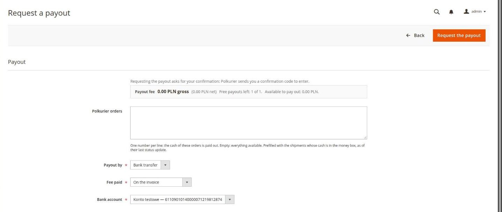

<!--
 ~ Copyright (c) 2026 Polkurier.pl
 ~ Licensed under the MIT License, see LICENSE.md
-->
# Cash on delivery

[User guide](README.md) › Cash on delivery

## Shipping with cash on delivery

When the customer paid with one of your cash on delivery payment methods, the shipment collects the
order total. You can change the amount, or remove it, for each shipment.

- **Orders shipped in parts**: each shipment starts with what the earlier ones don't collect yet
  (see [Shipping an order in parts](shipping-an-order.md#shipping-an-order-in-parts)).
- **Insurance**: some carriers insist on it with cash on delivery. For those, the shipment is
  insured automatically, for at least the amount it collects.
- **Currency**: cash on delivery and insurance are in złoty. If your store's base currency is the
  złoty, an order in another currency is converted at the rate it was placed at. If neither is the
  złoty, the amounts aren't filled in: enter them in złoty yourself.
- **At checkout**, these payment methods are hidden when the chosen carrier or pickup point can't
  collect cash.

## Setting it up

1. Under **Cash on delivery payment methods** in the
   [configuration](configuration.md#cash-on-delivery), select the payment methods that mean "the
   customer pays the courier", such as Magento's **Cash On Delivery**.
2. Add at least one bank account under **Polkurier > Settings > Bank accounts** (see
   [Bank accounts](synced-data.md#bank-accounts)). You can skip this if the money goes into your
   Polkurier money box or by postal order.
3. Choose the default payout time and where the money goes.

## Following the money

Each shipment with cash on delivery has a **COD status** in the shipment lists. It's updated along
with the delivery status.

| COD status | Meaning |
|---|---|
| Awaiting collection | the parcel hasn't been delivered yet |
| On its way to Polkurier | the courier collected the money and is passing it on |
| In the money box | Polkurier has it, in your money box |
| Payout pending | a payout of the money is being processed |
| Paid out | paid out to you |
| COD settled | settled with Polkurier in another way |
| Compensation | offset against a compensation |

## Payouts

To have money from your money box paid out, click **Request a payout** in **Polkurier > Sales >
Cash on delivery payouts**. The list shows the payouts you've requested: amount, fee, what was paid
out, account, number of shipments and status.

1. **Polkurier orders**: the shipments whose money you want paid out, one number per line. It
   starts with the shipments whose money is in the money box, as of their last status update.
   Leave it empty to pay out everything available.
2. **Payout by**: bank transfer or postal order. For a transfer, choose the **Bank account**, or
   **Another account number** and type it in.
3. **Fee paid**: how the payout fee is paid, for example from the money box or on your invoice.
4. Click **Request the payout**. Polkurier sends you a confirmation code by text message. Enter it
   in the **Confirm the payout** window, with your security PIN if your account uses one, and
   click **Confirm and save**.

The top of the form shows the fee, how many free payouts you have left and how much there is to
pay out. The fee is worked out again as you change the form.

Polkurier silently leaves out orders it can't pay out, so the form warns you about any order number
it doesn't know to be in the money box. If there's nothing to pay out, you're told so and no code
is sent.

A payout that hasn't been processed yet can be cancelled from the list with **Cancel**. The money
then stays in your money box.

Give the **Request payouts** permission only to people allowed to move money (see
[Permissions](permissions.md)). The confirmation code and PIN are never stored or logged.

Next: [Permissions](permissions.md)
