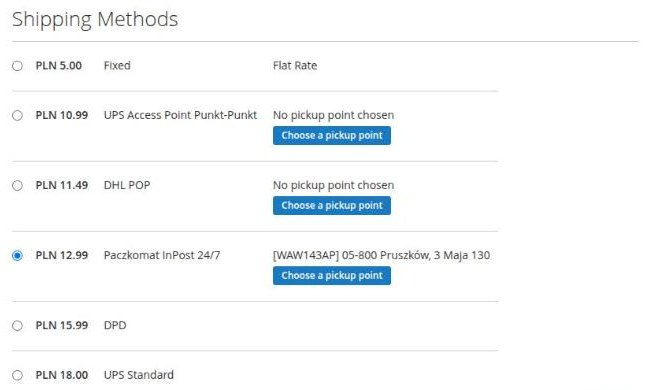
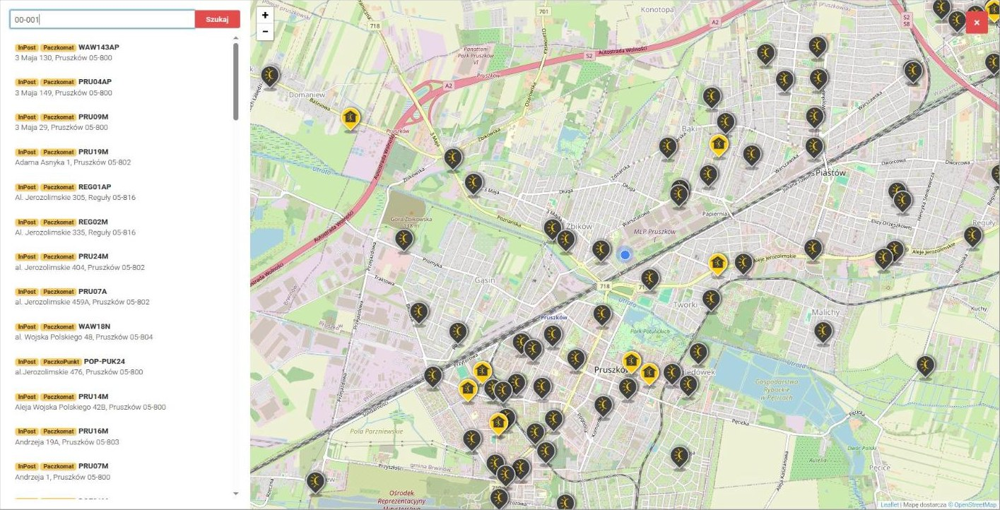

<!--
 ~ Copyright (c) 2026 Polkurier.pl
 ~ All Rights Reserved
-->
# Checkout

[User guide](README.md) › Checkout

## Shipping methods

At the shipping step, customers see each carrier you switched on that suits their cart. Each
carrier shows your label, your price and, if you uploaded one, its logo. To change any of these,
see [Carriers and prices](carriers-and-prices.md).

If Polkurier can't be reached at that moment, your carriers are still offered for addresses in
Poland.

## Pickup points

Carriers that deliver to parcel lockers or pickup shops get a **Choose a pickup point** button in
their row. The button selects the method and opens a map near the customer's postcode.

On the map, the customer can browse, search and pick a point. The chosen point then shows above
the button, and the button lets them pick another one.

- **Lockers and pickup points**: the customer can't continue to payment without choosing a point.
- **Couriers that can also deliver to a point**: the button is there too, but choosing a point is
  optional.
- **A point that has closed or stopped taking parcels** is refused before the order goes through,
  and the customer is asked to choose another one.
- **If the map isn't available**, carriers that deliver only to points aren't offered.

What the map shows is set on the configuration page, under
[Pickup point map](configuration.md#pickup-point-map).

## Cash on delivery

Your cash on delivery payment methods are hidden when the customer:

- picks a carrier that can't collect cash on delivery, or
- picks a pickup point that doesn't accept it. A note under the payment methods then says that
  another point lets the customer pay on delivery.

Which payment methods count as cash on delivery is set in
[Configuration](configuration.md#cash-on-delivery). If a point couldn't be checked with Polkurier,
it counts as one that accepts cash on delivery. If Polkurier can't be reached at the payment step,
the payment methods are left as they are.

## Multi-address checkout

Customers can also ship to several addresses at once (**Check Out with Multiple Addresses** in the
cart). They get the same choice of carriers and pickup points for each address, and each of the
resulting orders carries its own point.

This needs the multi-address checkout add-on; see
[Introduction](introduction.md#multi-address-checkout).

## After the order is placed

The chosen point is saved with the order and named after the shipping method, for example
"Paczkomat InPost, pickup point WAW01A (ul. Prosta 1, 00-001 Warszawa)".

- **Customers** see it wherever the shipping method is shown: at the payment step, in the order,
  invoice and shipment e-mails, in their account and on printed documents.
- **In the admin**, it's under **Shipping & Handling Information** on the order page. It can't be
  changed there.
- **When you ship the order**, the point is filled in on the shipment for you.

If the customer asks for another point, choose it when you ship the order. You can change the point
for each shipment, on the shipment screen or in the shipping label options.

Next: [Shipping an order](shipping-an-order.md)
