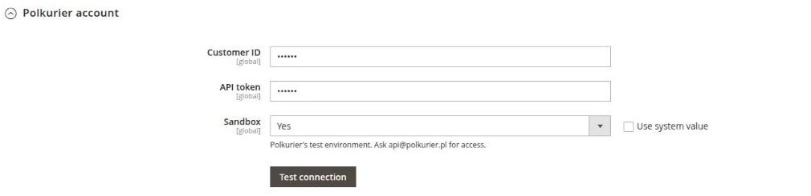

<!--
 ~ Copyright (c) 2026 Polkurier.pl
 ~ All Rights Reserved
-->
# Configuration

[User guide](README.md) › Configuration

All settings are on one page: **Stores > Configuration > Sales > Delivery Methods > Polkurier**.
The menu item **Polkurier > Settings > Configuration** opens the same page.

The **Polkurier account**, **Synchronization** and **Logging** settings are set once, for all
websites, in the **Default Config** scope. Most other settings can differ per website: pick the
website with the scope switcher at the top of the page. A few texts can also differ per store view;
they're marked below.

## Connecting your account

1. Enter your **Customer ID** and **API token**. You'll find them in the Polkurier panel.
2. Set **Sandbox**: Yes for a test account, No for your live account. It's Yes until you change it.
3. Click **Test connection**. It tells you whether Polkurier accepts the ID and token, before you
   save them.
4. Click **Save Config**.

The customer ID and token are stored encrypted and aren't shown again once saved. When you change
them, the carriers and other data are read again from the new account.

**Sandbox** sends everything to Polkurier's test environment, where shipments aren't real. A
sandbox account has its own customer ID and token; ask api@polkurier.pl for one.

- **Available carriers**: the carriers you actually work with. Only these appear under
  **Polkurier > Settings > Carriers**, at checkout and when you ship. With nothing selected, all of
  your account's carriers are available. A carrier you leave out keeps its settings and comes back
  as it was when you select it again.
- **Request timeout (seconds)**: how long to wait for Polkurier before giving up. The default is
  30 seconds. Checkout never waits more than 5 seconds; after that, it goes
  on without Polkurier's answer.
- **Identify orders to Polkurier by**: the number each Polkurier order carries. **Order ID** (the
  default) uses the Magento order's number, **Shipment ID** the shipment's. With **Shipment ID**,
  the Magento shipment gets the same number as in Polkurier, and a refused shipment leaves a gap in
  the shipment numbers. The order number is always sent too, so you can find the order in the
  Polkurier panel.
- **Installation ID**: leave it empty. Only a copy of the shop that uses the same Polkurier
  account, such as a staging copy, needs an ID of its own, so that its orders aren't mistaken for
  the shop's. It's [set on the copy itself](../developer-guide/installation.md#a-copy-of-the-shop).
  Orders already placed keep the ID they were placed with.

## The delivery method

The **Shipping method in checkout** group is at the top of the page:

- **Enabled**: offers the Polkurier methods at checkout on the website. Orders already placed with a
  Polkurier method can still be shipped while it's off.
- **Title**: used only in the admin, to tell the Polkurier methods apart from other shipping
  methods. Customers see each carrier's own label instead (see
  [Carriers and prices](carriers-and-prices.md)). Can be set per store view.
- **Ship to Applicable Countries** and **Ship to Specific Countries**: the countries the methods
  are offered for. Carriers that only deliver in Poland are never offered for other countries.
- **Show Method if Not Applicable** and **Displayed Error Message**: whether customers see a
  message instead of the methods when they can't be used.
- **Sort Order**: where the Polkurier methods appear among other shipping methods. The order of
  the carriers among themselves is set in the carriers list (see
  [Carriers and prices](carriers-and-prices.md)).
- **Cart value for price tiers**: the cart value that carriers priced by cart subtotal compare with
  their price tiers. It's the value after discounts, **With tax** (the default, as the customer sees
  it) or **Without tax**.

## Shipments

These are the defaults every new shipment starts with, on the shipment screen and on Magento's
shipment page alike. You can change all of them for each shipment.

### New shipments

- **Parcels go as**: **Parcel** (the default), **Envelope** or **Pallet**. New shipments start
  with this kind of parcel, and automatic packing uses only pack templates of this kind. If the
  carrier doesn't take this kind, the first kind it does take is used.
- **Additional services selected by default**, such as SMS notifications. They're ticked only for
  carriers that offer them.
- **Another sender on the label by default**: an address printed on the label as the sender
  instead of the real one, for carriers that offer it. You can choose from your addresses marked
  **Can be a cover address**.
- **Insure for the order total by default**. When only part of the order is shipped, it's insured
  for what its items are worth. With carriers that require insurance for cash on delivery,
  shipments with cash on delivery are always insured.
- **Shipment description**: the text in the shipment's description field. `%s` stands for the
  order number. Polkurier keeps up to 30 characters. The default is the order number alone, which
  makes the shipment easy to find in the Polkurier panel. Can be set per store view.

### Sender

These settings decide the sender address when you haven't marked a default one under
**Polkurier > Settings > Addresses**.

- **Fall back to the store's address**: ship from the address in **General > Store Information**.
- **Fall back to the shipping origin**: ship from the address in **Sales > Shipping Settings >
  Origin**. On by default. With both on, the store's address comes first, and the shipping origin
  is used when the store's address is incomplete.
- **Sender e-mail with the store's addresses**: which of the store's e-mail addresses goes on the
  shipment as the sender's, when it ships from either of those addresses.

### Parcels

- **Parcel weight**: the weight sent for a parcel packed in a pack template.
  - **What the products in it weigh** (the default): the products' weights added up, plus the
    template's **Tare** if it has one.
  - **The pack template's weight**: the template's **Maximum weight**, whatever is in the parcel.
    Choose this if your products' weights are missing or unreliable.

  A parcel holding a product without a weight always gets its template's weight. A parcel without
  a template weighs what's in it. You can still change any parcel's weight before you ship.
- **Pack new shipments automatically**: Yes (the default) packs the items into your pack templates
  as soon as you start a shipment, on the shipment screen and in Magento's packaging window. With
  No, a shipment starts with one parcel of your default pack template, or none; **Pack
  automatically** still packs the items when you click it.
- **Packing margin (cm)**: extra space added to each side of every product when packing
  automatically. Use it for products a little bigger than their shipping dimensions say. 0 by
  default.
- **Pack template weight limits**: what automatic packing does with the templates' **Maximum
  weight**.
  - **Only warn about heavier parcels**: packs by size and points out parcels over the limit.
  - **Keep parcels under them where possible**: splits parcels or takes a bigger template to stay
    under the limit, which may mean more parcels. An item too heavy for every template is still
    packed, and its parcel is pointed out.

### Cash on delivery

- **Cash on delivery payment methods**: the payment methods where the customer pays the courier.
  Orders paid this way are shipped with cash on delivery for the order total, or for what's left of
  it when the order ships in parts. At checkout, these payment methods are hidden when the chosen
  carrier or pickup point can't collect cash.
- **Cash on delivery payout time**: how soon Polkurier pays out the money after delivery:
  **Standard time**, **Next day** or **Within 4 days**. Faster payouts may cost more; check your
  Polkurier contract.
- **Cash on delivery paid out to**: **Bank account**, **Polkurier money box** or **Postal order**.

## Pickup point map

- **Initial latitude**, **Initial longitude** and **Initial zoom**: where the map opens when the
  shipping address doesn't give a better starting point. The default is central Warsaw.
- **Show the list of points**: shows a list next to the map.
- **Show the search field**: lets customers search for an address or a point.
- **Show only points that**: shows only points that **Hand out parcels**, **Accept parcels for
  sending** or **Take cash on delivery**. With nothing selected, the map shows all points.

All but the last can be set per store view.

## Synchronization

- **Synchronize with Polkurier on schedule**: keeps the data under **Polkurier > Settings** in step
  with your Polkurier account. Addresses, bank accounts and pack templates are checked every hour.
  The carriers your account offers are checked once a day. Changes you make in Magento are sent to
  Polkurier straight away either way; the scheduled runs pick up changes made in the Polkurier
  panel.
- **Update shipment statuses on schedule**: follows each shipment until it's delivered, returned or
  cancelled.
- **Update shipment statuses**: how often: every 10, 15, 20 or 30 minutes (the default), or every
  hour. More often keeps statuses fresher but sends more requests to Polkurier.
- **Status webhook secret**: lets Polkurier tell the shop about a status change straight away,
  instead of waiting for the next scheduled update. Leave it empty to keep this off. To set it up:
  1. In the Polkurier panel, under **Ustawienia > Aplikacje zewnętrzne**, add an application of the
     WebHooks type.
  2. Give it the URL shown under this field. The shop's address must start with https and be
     reachable from the internet.
  3. Copy the secret the panel then shows, and paste it here.

  Polkurier sends each change only once, so keep the scheduled updates on as well: they catch
  anything the webhook missed, and they can run less often. Polkurier sends the changes of all the
  account's orders to every webhook of the account, so a copy of the shop, such as a staging copy,
  should use a Polkurier account of its own.

The scheduled updates run through Magento's
[scheduled jobs (cron)](../developer-guide/installation.md#cron) on the server.
Shipments whose result was unclear are also checked on schedule, every 10 minutes. That check
can't be switched off, because it stops the same order from being shipped twice (see
[When the result is unclear](shipping-an-order.md#when-the-result-is-unclear)).

## Logging

The module keeps a [log](../developer-guide/logging.md) of its requests to Polkurier on the
server. It's what Polkurier support asks for when something goes wrong. Problems of the module
itself are always logged.

- **Log failed requests**: logs requests that failed, with Polkurier's answer. On by default. The
  settings below show only when it's on.
- **Log all traffic of**: also logs successful requests of the kinds you select, which helps if
  Polkurier support asks for details. By default, these are all requests that change something on
  your Polkurier account, such as placing and cancelling shipments, payouts or saving addresses.
- **Log personal data**: off by default, so names, addresses, e-mail addresses, phone numbers, tax
  numbers and bank account numbers are hidden. Turn it on only while you need them, for example to
  show support exactly what was sent.
- **Save files**: off by default, so only the size of a label, protocol or other file is logged.
  When it's on, each file is saved on the server. A label shows the recipient's name and address,
  even with **Log personal data** off.
- **Save files in**: the folder on the server for those files. Leave it empty for the default
  folder next to the log. It can't be a folder the website shows to the public.

Your API token, security PINs and confirmation codes are always hidden in the log. With **Log
personal data** and **Save files** off, the log is safe to send to Polkurier support. The module
doesn't delete old logs or saved files, so have them deleted once they're no longer needed: they
may hold your customers' names and addresses.

Next: [Carriers and prices](carriers-and-prices.md)
