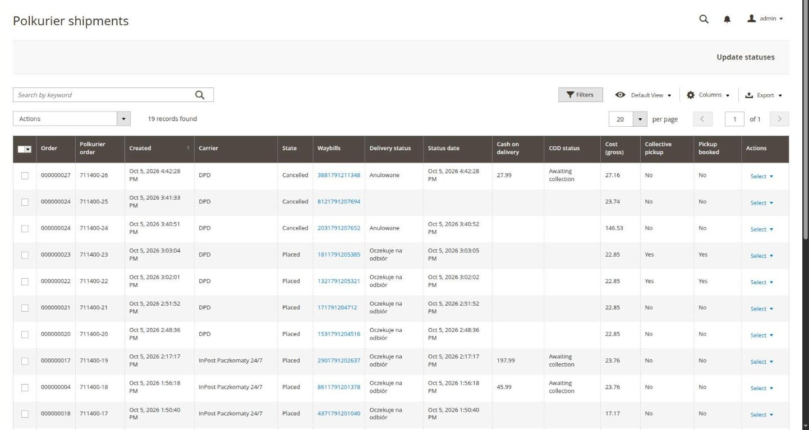
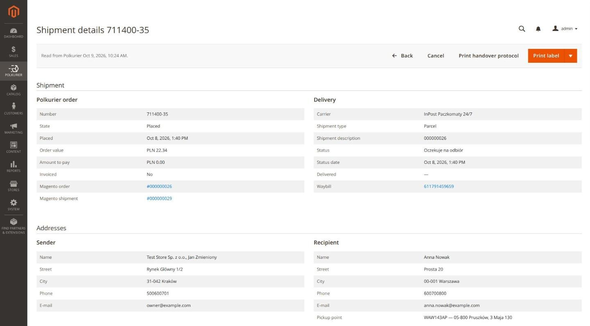

<!--
 ~ Copyright (c) 2026 Polkurier.pl
 ~ Licensed under the MIT License, see LICENSE.md
-->
# Managing shipments

[User guide](README.md) › Managing shipments

## Where to find them

- **Polkurier > Sales > Shipments** lists the shipments of all orders, newest first. **Search by
  keyword** finds a shipment by its order number, Polkurier order, waybill, carrier, description,
  the recipient's postcode or phone, delivery status, last error, or the customer's name or
  e-mail.
- **On the order page**, the **Polkurier** tab lists the order's shipments, with the same search,
  filters and **Actions** menu. It includes shipments that weren't placed, with the reason under
  **Last error**.
- **On the order page**, the Shipments tab has a **Polkurier order** column. Click it to open that
  shipment's details.
- **On a Magento shipment's page**, the **Polkurier order** button opens the details.



**Polkurier > Sales > Orders** opens Magento's orders list, showing only orders placed with a
Polkurier delivery method. It uses the **Shipping carrier** filter, which is also in the list's
**Filters** for any carrier.

## What the list shows

| Column | |
|---|---|
| Order | the Magento order |
| Polkurier order | the order number in your Polkurier account |
| Created | when the shipment was placed |
| Carrier | the carrier it goes with |
| Order state | where it stands with Polkurier (see below) |
| Waybills | the carrier's tracking numbers, linked to the carrier's tracking page |
| Delivery status, Status date | the latest status the carrier reported |
| Cash on delivery, COD status | the amount to collect and where the money is (see [Cash on delivery](cash-on-delivery.md#following-the-money)) |
| Cost (gross) | what Polkurier charged you |
| Collective pickup, Pickup booked | whether it waits for a collective pickup, and whether that's booked |
| Last error | why the last action on it failed, if it did |

The **Order state**:

```
Sending ............ being placed right now
Placed ............. accepted by Polkurier; can still be cancelled ........ Cancelled
Outcome unknown .... no clear answer; being looked for in your account .... Placed or Not placed
Not placed ......... failed or not found; can be sent again ............... Sending
Cancelled .......... cancelled here or in the Polkurier panel
```

How **Outcome unknown** is settled is in
[When the result is unclear](shipping-an-order.md#when-the-result-is-unclear).

## Shipment details

**Details** in a shipment's row opens everything about it on one page.



Besides what the list shows, it has the sender and recipient, the services and handover, the items
shipped, what each parcel holds, and what Polkurier charges for each item. Under the Polkurier
order, **Order value** is what Polkurier charges for the shipment, **Amount to pay** what's still
due of it, and **Invoiced** whether it's invoiced. **Carrier tracking** lists every scan the carrier
reported, newest first.

The page shows the saved data at once, and updates itself from Polkurier each time it opens, unless
the shipment is finished. The bar with the buttons says when it was last read from Polkurier, and
shows the update while it runs.

If Polkurier treated a parcel as another type than it was sent as (for example a standard parcel
over the carrier's weight limit as non-standard), the page says so; it's priced as that type.

For a shipment whose result is unclear, the page shows the order as it was sent. Where Polkurier's
copy of the order leaves something empty, such as some carriers' extra fields, the page shows what
was sent, marked **(as sent)**.

For parcels dropped off, **Handover to the carrier** shows the drop-off point: the sender address's
point, or any of the carrier's points.

## Actions on a shipment

The buttons on the details page and the **Actions** in a row depend on the shipment's state.

For a placed shipment:

- **Print label** downloads the shipping label as a PDF. On the details page, the arrow next to it
  offers the formats of thermal label printers: ZPL (203 or 300 dpi), EPL and Datamax. A carrier
  that can't print in the chosen format sends its own, usually a PDF; the file is named to match.
- **Print handover protocol** downloads the protocol the courier signs when collecting.
- **Update status**, in a row's **Actions**, asks Polkurier for the current delivery and cash on
  delivery status, and the carrier's scans. The details page does this itself.
- **Cancel** cancels it in Polkurier (see [Cancelling](#cancelling)). This can't be undone.
- **Create Magento shipment** shows when the Magento order isn't shipped yet (see
  [When the Magento shipment is missing](#when-the-magento-shipment-is-missing)).

For a shipment whose outcome is unknown, **Reconcile** looks for it in your Polkurier account
straight away. If it finds an order that may be the shipment but can't be sure, it names it. If
that's the right one, open the shipment's details and use **Link to a Polkurier order** with its
number. Only an order this shop placed for that shipment can be linked, not one placed in the
Polkurier panel or by another shop, and not one already linked to another shipment.

For a shipment that wasn't placed, see [When a shipment isn't placed](#when-a-shipment-isnt-placed).

**View order** in a row opens the Magento order.

## Several shipments at once

Tick the shipments in the list, or on an order's **Polkurier** tab, and pick from the **Actions**
menu:

- **Print labels**: one file with all their labels, as a PDF or in a label printer's format. A label
  printer's format takes up to 50 orders at a time.
- **Print handover protocol**: one protocol for all of them.
- **Update statuses**.
- **Book a collective pickup** (see [Collective pickups](#collective-pickups)).

Shipments that can't take part, such as ones that weren't placed, are skipped. Shipments cancelled
in the Polkurier panel, or not found there, are left out of the labels and protocol, and a warning
names them.

## Delivery status

With **Update shipment statuses on schedule** on, each placed shipment is followed until it's
finished, as often as **Update shipment statuses** says. With the status webhook set up (see
[Configuration](configuration.md#synchronization)), each change shows up straight away. **Update
statuses** above the list updates every unfinished shipment at once, even with the schedule off.

A shipment is finished when it's:

- cancelled;
- delivered, and with cash on delivery, the money is paid out, settled or offset against a
  compensation;
- on its way back to you, with nothing changed for 14 days.

Finished shipments aren't checked any more, but **Update status** still works for them.

Customers can follow the parcel from their order page: the tracking numbers link to the carrier's
tracking page.

## Collective pickups

Instead of booking a courier for each shipment, place shipments for a later collective pickup
(the handover **A courier collects them later, with other shipments**). Then book one courier visit
for all of them:

1. In **Polkurier > Sales > Shipments**, select the shipments. Filtering by **Collective pickup**
   helps.
2. Choose **Book a collective pickup** in the **Actions** menu.
3. Enter the date and time window, and confirm.

Only placed shipments that wait for a collective pickup and aren't booked yet are included; the
form names the ones left out. You then see which shipments were booked, and Polkurier's reason for
any that weren't.

## Cancelling

**Cancel** cancels the Polkurier order. It's offered as the Polkurier panel offers it: not once the
carrier has the parcel, not for an invoiced order, and not for a freight order Polkurier has
confirmed. Polkurier may still refuse, and says why. A Polkurier order cancelled in the Polkurier
panel is treated the same once its status is next updated.

The Magento shipment stays, with its items, but loses the cancelled order's label, packages and
tracking numbers. The order's comments say which shipment was cleared.

To send the parcel again, open that Magento shipment and either:

- click **Create Shipping Label** and pack the parcels in Magento's packaging window; or
- click **Add a Polkurier order** to use the Polkurier shipment screen.

The new Polkurier order goes on the same Magento shipment, and its waybills become the tracking
numbers. A Magento shipment has only one active Polkurier order. Cancelled ones stay listed on the
order's **Polkurier** tab. The customer isn't e-mailed again about the shipment.

## When a shipment isn't placed

When Polkurier is down, busy or out of reach, the shipment is listed as **Not placed**, with the
reason. It's kept as it was filled in, so it can be sent again, and the order's next attempt reuses
it. **Discard** removes it.

If it's neither sent again nor discarded, you get an admin notification a day after it was last
tried. A day after that, it's removed, with a note in the order's history.

When Polkurier refuses a shipment (a parcel too big, say), nothing is saved. You see the reason at
once; change the shipment and place it again.

A shipment whose result is still unclear after an hour gets an admin notification, once.

## Sending again what wasn't placed

**Send again** opens the shipment screen filled in as before, with the reason it wasn't placed
shown above. Use it once Polkurier is back. It's in the row of a shipment that wasn't placed and on
its details page, for the order's latest attempt, while the order still has something to send.

## A Magento shipment without a Polkurier order

A Magento shipment can be created without a Polkurier order: saved on Magento's shipment page
without **Create Shipping Label**, or made through another integration. Its page has two ways to
add the Polkurier order, which then goes on that shipment with its items:

- **Create Shipping Label**, with Magento's packaging window;
- **Add a Polkurier order**, which opens the Polkurier shipment screen.

Neither e-mails the customer by itself. On the shipment screen, **Email the customer about the
shipment** is offered while the customer hasn't been e-mailed about that shipment. Otherwise,
Magento's **Send Tracking Information** on the shipment's page sends the e-mail with the new
tracking numbers.

## On Magento's shipment page

On an order placed with a Polkurier delivery method, a Magento shipment's page shows, above
**Payment & Shipping Method**:

- **Polkurier orders**: every Polkurier order the shipment has had, cancelled ones included;
- **Polkurier shipping label**, when the shipment has no active Polkurier order: the options used
  by **Create Shipping Label**.

Its **Shipment History** notes each Polkurier order, its cancellation and its delivery. These notes
are internal: the customer isn't notified and doesn't see them.

## When the Magento shipment is missing

If the Magento order couldn't be shipped when Polkurier accepted the shipment (the order was on
hold, say), the Polkurier order stands and **Last error** gives the reason. The Magento shipment is
created with a later status update, once nothing blocks it, or straight away with **Create Magento
shipment**. If it's still missing after an hour, you get an admin notification, once.

If the order has nothing left to ship by then, the Polkurier order goes on the order's latest
Magento shipment that has none. If there's no such shipment, **Last error** says so.

Next: [Cash on delivery](cash-on-delivery.md)
