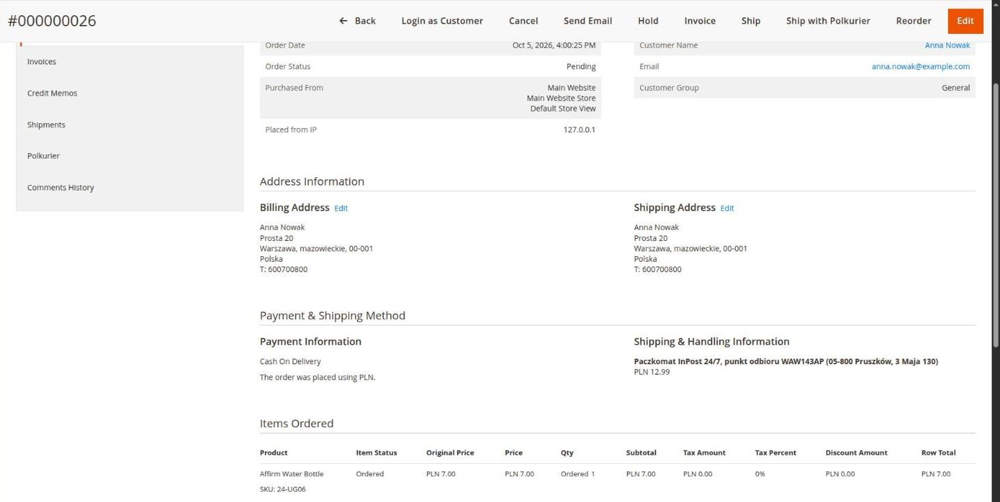
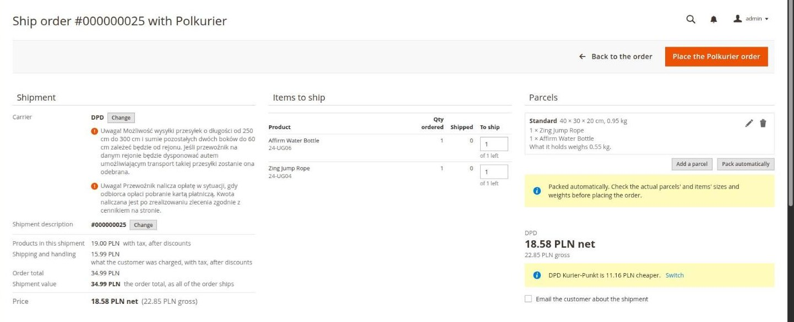
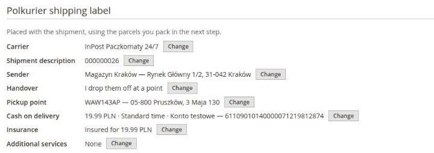

<!--
 ~ Copyright (c) 2026 Polkurier.pl
 ~ All Rights Reserved
-->
# Shipping an order

[User guide](README.md) › Shipping an order

To ship an order, open it and click **Ship with Polkurier**. Check the shipment, then click
**Place the Polkurier order**.



The delivery method and pickup point the customer chose are under **Shipping & Handling
Information**. Polkurier buttons show only on orders placed with a Polkurier delivery method.

## Two ways to ship

You can also use Magento's own **Ship** button, which opens Magento's shipment page.

| | Polkurier shipment screen | Magento's shipment page |
|---|---|---|
| Opened with | **Ship with Polkurier** | **Ship** |
| Prices before placing | every carrier's price | no |
| Recipient | can be corrected on the screen | the order's shipping address; change it on the order page first |
| Parcels | typed in, or taken from pack templates | packed in Magento's packaging window |
| Label | printed from the Polkurier shipment | stored with the Magento shipment |
| Part of the order | under **Items to ship** | choose the quantities to ship |

Either way you get a Polkurier order and a shipped Magento order, with the waybill numbers as
tracking numbers. A comment on the order gives the Polkurier order number. On Magento's shipment
page you can also save the shipment without a label and add its Polkurier order later (see
[A shipment without a label](#a-shipment-without-a-label)).

## On the Polkurier shipment screen

1. Click **Ship with Polkurier** on the order page. The screen opens already filled in (see
   [What's filled in for you](#whats-filled-in-for-you)).
2. Check the carrier and the price.
3. Check the parcels: size, weight and what's in them.
4. Click **Place the Polkurier order** at the top of the page.



**Change** opens a section in a window. **Done** checks what you entered; **Cancel** puts back
what was there. If something is missing, such as a pickup point, a collection date or a parcel
size, nothing is sent: each section with a problem turns red, and **Fix** takes you to it.

When Polkurier accepts the shipment, the Polkurier order's page opens and the Magento order is
shipped.

**Email the customer about the shipment**, under the price, sends Magento's shipment e-mail once
Polkurier has accepted the shipment and the Magento shipment is created; if the result is unclear,
once the order is found placed. It's unticked to start with, as on Magento's shipment page. It
isn't offered when the Polkurier order goes on a Magento shipment the customer was already
e-mailed about, or when Magento's shipment e-mails are off (**Stores > Configuration > Sales >
Sales Emails > Shipment**).

If Polkurier refuses the shipment (a missing phone number, a parcel too big for the carrier, a
date the courier doesn't come on), you see the reason. Everything you entered stays: fix it and
try again.

If the Magento order can't be shipped at that moment, for example because it's on hold, the
Polkurier order still stands (see
[When the Magento shipment is missing](managing-shipments.md#when-the-magento-shipment-is-missing)).

### Shipment

- **Carrier**: **Change** lists your carriers with what Polkurier would charge you, cheapest
  first. Badges show which deliver to pickup points and which collect cash on delivery. Carriers
  that can't take this shipment are under **Show … more**.
- **Shipment description**: printed on the label. It starts as the order number.
- **Shipment value**: the order total when the whole order ships; for a part, what that part is
  worth.
- **Price**: what the carrier charges you, not what the customer paid. It shows once every parcel
  has a size and weight. If Polkurier refuses to price the shipment, the reason shows in red.

When you switch carriers, the options the new one doesn't offer disappear. The pickup point is
cleared, and comes back if you switch back.

### Items to ship

Every item the order still has to ship. The quantity starts at everything that's left. Lower it,
or set it to 0, to ship the order in parts (see
[Shipping an order in parts](#shipping-an-order-in-parts)). When everything is already shipped, a
note says which Magento shipment the new Polkurier order goes on.

### Additional services

- **Cash on delivery** starts with what's left to collect on the order. **Change** sets the
  amount, the payout time and where the money goes.
- **Insurance** covers the cash on delivery amount, or else the shipment value. **Change** sets
  another value.
- The carrier's other services, and **Another sender on the label** if you have addresses marked
  **Can be a cover address**.

A service the chosen carrier doesn't offer is marked, with **Fix**.

### Sender

The address the parcels go out from. **Change** picks another, or **A new address** (see
[Typing in a sender, an account or a parcel](#typing-in-a-sender-an-account-or-a-parcel)). Next
to it, how the parcels reach the carrier:

- **A courier collects them**: the first free date and time window is chosen; pick another if you
  like.
- **I drop them off at a point**: the drop-off point starts as your sender address's. **Choose on
  map** picks another.
- **A courier collects them later, with other shipments**: booked later for many shipments at once
  (see [Collective pickups](managing-shipments.md#collective-pickups)).

### Recipient

Name, address, phone and e-mail, with **Change** to correct them. For pickup point carriers, the
point is shown with its current address; **Choose on map** picks another. A point that has closed
is marked in red: choose another.

### Parcels

One line per parcel. The pencil edits a parcel, the bin removes it. **Add a parcel** starts from
one of your pack templates, or from **A parcel without a template**. **Pack automatically** packs
the items again (see [Packing automatically](#packing-automatically)).

In a parcel's window, **What it holds** (optional) says which items go in it. You're warned when a
parcel weighs less than what's in it.

Below the parcels is the price. If another carrier is cheaper, **Switch** changes to it.

## On Magento's shipment page

1. Click **Ship** on the order page. Magento's **New Shipment** page opens.
2. Check the **Polkurier shipping label** section. **Change** edits a line; **Apply** keeps the
   change.
3. Choose the quantities to ship and tick **Create Shipping Label**: the label is what places the
   Polkurier order. Tick **Email Copy of Shipment** to e-mail the customer.
4. Click **Submit Shipment**. Magento's packaging window opens.
5. Add a package for each parcel and put the items in it. Enter its weight (kg) and size (cm), and
   pick its parcel type as the package type. Picking one of your pack templates in the **Pack
   template** column fills these in.
6. Click **Save** in the packaging window.



A line turns red when the carrier needs something that's missing, such as a pickup point or a
collection date. The packaging window doesn't open until you fix it. A red cash on delivery line
that collects more than is left on the order is only a warning.

A later collective pickup is offered for every carrier here; Polkurier refuses the label if the
carrier can't do it. Likewise, **Additional services** lists every service any of your carriers
offers: untick the ones the chosen carrier doesn't.

With **Pack new shipments automatically** on, the items are already packed when the packaging
window opens. **Pack automatically**, next to **Add Package**, packs them again. Check the sizes
and weights before saving. Envelopes, pallets and parcels can't be mixed in one shipment; you're
told when you save, before anything is sent.

When Polkurier accepts the shipment, the Magento shipment is created with the waybills as
tracking numbers, and Magento sends the e-mail if it was ticked. **Print Shipping Label** gives you the Polkurier label, and the **Polkurier
order** column on the order's Shipments tab opens the Polkurier shipment (see
[Managing shipments](managing-shipments.md)).

If the label isn't ready yet, the shipment is still created and you're told. Print the label later
from the Polkurier shipment, or click **Create Shipping Label** on the Magento shipment: it fetches
the label, without placing a new order.

If Polkurier refuses the shipment, the reason shows in the packaging window and nothing is
created or e-mailed. Change the options or packages and try again.

### A shipment without a label

Without **Create Shipping Label**, **Submit Shipment** saves the Magento shipment as Magento does,
with no Polkurier order, and e-mails the customer if **Email Copy of Shipment** is ticked. That
lets you tell the customer the order is being prepared before anything is sent with Polkurier.

The Polkurier order is added later from the shipment's page, with **Create Shipping Label** or
**Add a Polkurier order** (see
[A Magento shipment without a Polkurier order](managing-shipments.md#a-magento-shipment-without-a-polkurier-order)).

### Before your first label

Magento won't create any label, for any carrier, until these are filled in:

- the store's name and phone number (**Stores > Configuration > General > General > Store
  Information**);
- the shipping origin (**Stores > Configuration > Sales > Shipping Settings > Origin**);
- a first and last name on your admin user account.

The parcels still go out from your Polkurier sender address.

## What's filled in for you

Both ways start from the order and your [defaults](configuration.md#shipments):

- **Carrier** and **pickup point**: the customer's choice.
- **Sender**: your default sender address, or the store's address or shipping origin if you allow
  those. With none of these, you type one in.
- **Recipient**: the order's shipping address.
- **Parcels**: packed automatically when that's on and every product has its shipping dimensions.
  Otherwise one parcel of your default pack template, if you have one.
- **Cash on delivery**: the order total, if the customer chose one of your cash on delivery
  payment methods, paid out to your default bank account. When the order ships in parts, only
  what's left to collect.
- **Insurance and additional services**: as your defaults say, if the carrier offers them.
- **Handover**: a courier pickup, or dropping the parcels off where the carrier prefers that.

## Packing automatically

Products have a **Shipping dimensions** group on their edit page: the length, width and height in
centimetres of one unit as shipped, packaging included. With these and the product's weight, the
items are packed into your pack templates, in as few parcels as possible.

- Only templates of one kind are used: parcels, envelopes or pallets (see **Parcels go as** in
  [Configuration](configuration.md#parcels)).
- An item too big for every template gets a parcel of its own size. Enter its weight yourself.
- A parcel weighs what **Parcel weight** says. A parcel with a product that has no weight takes
  its template's weight.
- A parcel heavier than its template's **Maximum weight** is pointed out, or avoided if **Pack
  template weight limits** says so.
- **Packing margin** adds space on every side (see [Configuration](configuration.md#parcels)).

The result is an estimate and may use a bigger box, or one more, than a person would: check the
parcels before placing the order. If a product has no dimensions, the screen says which.

A configurable product uses the dimensions of the option ordered, or the product's own if the
option has none. A bundle shipped together is packed as one box: its own dimensions, or else its
parts stacked flat. Give a bundle its own dimensions if its parts pack tighter than that.

## Shipping an order in parts

Ship only the quantities that go out now, on either screen. Each part gets its own Magento
shipment and Polkurier order. **Ship with Polkurier** stays on the order page while anything is
left to ship.

**Cash on delivery** collects what the items in the part are worth, with tax and after discounts.
The part that ships everything still left collects everything left, shipping included. No part
collects more than is left. **Insurance** follows the cash on delivery amount, or else what the
items are worth.

For example, a 250 zł order of a 150 zł item and an 85 zł item, with 15 zł shipping, goes out in
two parts. The first collects 150 zł, the second the 100 zł left.

Cancelled and refused Polkurier orders don't count towards what's collected. One whose result is
unclear does, until it's settled. Both amounts follow the quantities until you set them yourself.

To collect the shipping with the first part instead, tick **Include shipping and handling in cash
on delivery and insurance** on the Polkurier shipment screen. Magento's shipment page has no such
option.

## Typing in a sender, an account or a parcel

You can ship without anything stored in **Polkurier > Settings**:

- the sender can be **A new address**. Tick **Save to your addresses for later shipments** to keep
  it;
- cash on delivery can go to **A new bank account**. Tick **Save to your bank accounts for later
  shipments** to keep it; it then needs confirming like any bank account (see
  [Bank accounts](synced-data.md#bank-accounts)). This shipment's money goes to that number either
  way;
- a parcel without a template can be kept with **Save as a pack template for later shipments**
  (**Save as a pack template** in Magento's packaging window).

They're saved once Polkurier accepts the shipment. The first address, bank account or pack
template you have becomes the default.

## When you ship with another carrier or point

You can send the parcels with another carrier, or to another pickup point, than the customer
chose. The order then shows what the parcels actually went with, and keeps the customer's choice
under **Chosen by the customer**. The shipping amount the customer paid doesn't change. If you
cancel that Polkurier order and the order has no other placed one, the customer's choice comes
back.

## When the result is unclear

Now and then Polkurier gives no clear answer, for example when the connection drops at the wrong
moment. The shipment may or may not have been placed. It's never simply sent again, since that
could create a second shipment you'd pay for. You can't place another one for the order until it's
settled.

```
you place a shipment
├── Polkurier accepts it ............. Placed
├── Polkurier refuses it ............. you see the reason: fix it and place it again
├── Polkurier can't be reached ....... Not placed, with the reason: send it again
└── no clear answer .................. Outcome unknown
    │
    │  your Polkurier account is checked every 10 minutes,
    │  or straight away with Reconcile in the shipment's row
    │
    ├── found ........................ Placed, and the Magento order is shipped
    ├── found more than once ......... the earliest kept, the others named on the order
    └── not found after 15 minutes ... Not placed: ship the order again
```

If more than one is found, cancel the ones you don't need in the Polkurier panel. They're named in
a comment on the order and under **Last error**.

On Magento's shipment page, an unclear result creates no Magento shipment yet. Once the Polkurier
order is found, the order is shipped automatically. Don't create the label again meanwhile.

The automatic check needs Magento's cron to run.

Next: [Managing shipments](managing-shipments.md)
