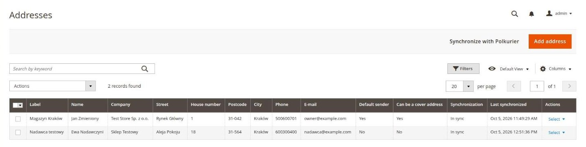
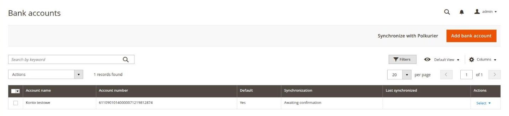
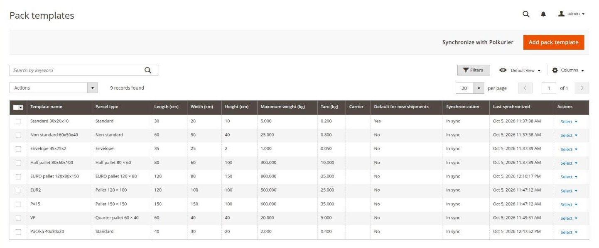

<!--
 ~ Copyright (c) 2026 Polkurier.pl
 ~ Licensed under the MIT License, see LICENSE.md
-->
# Addresses, bank accounts and pack templates

[User guide](README.md) › Addresses, bank accounts and pack templates

Your sender addresses, bank accounts and pack templates are kept both in Magento and in your
Polkurier account, and you can edit them in either place. In Magento, they're under **Polkurier >
Settings**.

## Addresses

Your sender addresses: where couriers collect parcels, and what's printed as the sender.

- **Display name**: your own name for the address, shown in lists.
- **Name**, **Company**, **Street**, **House number**, **Flat number**, **Postcode**, **City**,
  **Province**, **Country**, **Phone**, **E-mail**: the address itself.
- **Default sender**: chosen for new shipments. Mark just one address. If several are marked, the
  first one found is used.
- **Can be a cover address**: the address may be printed on labels instead of the real sender,
  for example your brand's address when parcels leave a warehouse. For carriers that offer it,
  choose the cover address per shipment with **Another sender on the label**, under additional
  services. You can also set one for every shipment in [Configuration](configuration.md#sender).

With no default sender, shipments can use your store's address or its shipping origin instead.
See **Fall back to the store's address** and **Fall back to the shipping origin** in
[Configuration](configuration.md#sender).

## Bank accounts

The accounts where Polkurier pays out the cash on delivery money you collect.

- **Account name**: your own name for the account.
- **Account number**: an IBAN or a Polish account number (26 digits).
- **Default**: chosen for shipments with cash on delivery.

### Confirming a bank account

Polkurier asks you to confirm every new or changed bank account. When you click **Save**, a window
asks for:

- **your security PIN**, if your Polkurier account protects bank accounts with one, or
- **a confirmation code** that Polkurier sends you by text message. The window says where it went
  and how long it's valid. Enter it and click **Confirm and save**. **Send a new code** sends
  another one.

**Cancel** saves nothing.

If Polkurier doesn't accept the confirmation, the account is still saved in Magento, marked
**Awaiting confirmation**. Open it and save it again to confirm it. The same applies to a bank
account saved while shipping (see
[Typing in a sender, an account or a parcel](shipping-an-order.md#typing-in-a-sender-an-account-or-a-parcel)).
Changes made in the Polkurier panel still come through in the meantime.

### Deleting a bank account

If your bank accounts are protected by a PIN, open the account and click **Delete** on the form. A
window asks for the PIN. Otherwise, **Delete** in the list works as for addresses and templates.

## Pack templates

The parcels you ship most often.

- **Template name** and **Description**: your own name and note for the template.
- **Parcel type**: a standard, non-standard or long parcel, an envelope, or a pallet: quarter
  (60 × 40), half (80 × 60), EURO (120 × 80, standard or non-standard), 120 × 100, 120 × 120 or
  150 × 150. Envelopes are sent as an envelope shipment, pallets as a pallet shipment, anything
  else as parcels.
- **Length**, **Width** and **Height**, in centimetres.
- **Maximum weight**, in kilograms: the most a parcel of this template may weigh, contents
  included. When **Parcel weight** in the configuration is set to **The pack template's weight**,
  parcels of this template are also sent with this weight.
- **Tare**, in kilograms, optional: the weight of the packaging itself. It's added when a parcel is
  weighed by its contents, and automatic packing counts it toward the **Maximum weight**. It's kept
  in Magento only; the Polkurier panel doesn't show it.
- **Cash on delivery**, **Insurance**, **Carrier** and **Additional services**: kept in your
  Polkurier account, for use in the Polkurier panel.
- **Default for new shipments**: new shipments start with one parcel of this template, unless
  they're packed automatically (see
  [Packing automatically](shipping-an-order.md#packing-automatically)).

When you pick a template for a parcel, its type, size and weight are filled in. You can still
change them for that parcel.

Templates with a size are also the boxes that automatic packing puts items into. When shipping, a
parcel heavier than its template's **Maximum weight** is pointed out. Whether automatic packing
also keeps parcels under that weight is set with **Pack template weight limits** (see
[Configuration](configuration.md#parcels)).

## Editing in the lists

- **Quick edits**: click a row in any of the three lists, change its fields and click **Save** under
  the row. Tick several rows to edit them together. Each change is sent to Polkurier at once; if
  Polkurier refuses it, the row shows why.
- **Bank accounts changed in the list** are saved in Magento but can't be confirmed there. A message
  reminds you to open the account and confirm it.
- **Save and Continue Edit** on the edit forms saves without taking you back to the list.
- **Search by keyword** finds entries by name and, for addresses and bank accounts, by their
  details.
- **Names must be unique** within each list, regardless of upper or lower case.
- **Deleting several at once**: tick them and choose **Delete** from **Actions**. Any that can't be
  deleted stay in the list, with the reason shown; the others are deleted.

## Keeping Magento and Polkurier in step

- **Saving in Magento** sends the change to Polkurier straight away.
- **Changes made in the Polkurier panel** come through with the hourly synchronization. To get
  them at once, click **Synchronize with Polkurier** on any of these three pages.
- **If the same entry changed on both sides** since the last synchronization, the more recent
  change wins. A change made in the Polkurier panel counts from when Magento first sees it, so
  edit an entry in one place at a time.
- **Deleting in Magento** deletes the entry in Polkurier too.
- **Deleting in Polkurier** removes the entry from Magento, unless you edited it in Magento in the
  meantime. Your edit is then sent back to Polkurier.

The **Synchronization** column shows each entry's state:

| State | Meaning |
|---|---|
| In sync | Magento and Polkurier agree. |
| Waiting to be sent | Changed in Magento but not sent yet, usually because Polkurier couldn't be reached. The next synchronization sends it. |
| Error | Polkurier refused the change. The reason is under **Sync error**. |
| Awaiting confirmation | A bank account change still needs your PIN or confirmation code. |

**Last synchronized** shows when each entry was last in step. The **Sync error** and **Polkurier
ID** columns are hidden at first; turn them on under **Columns**.

Next: [Checkout](checkout.md)
